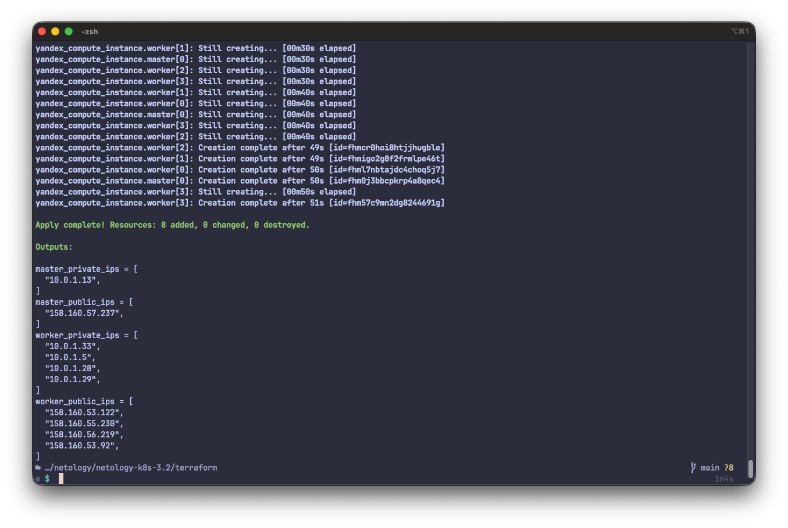
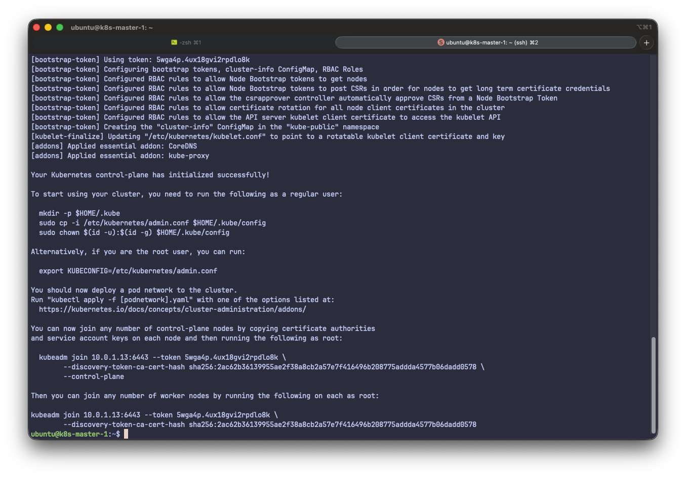
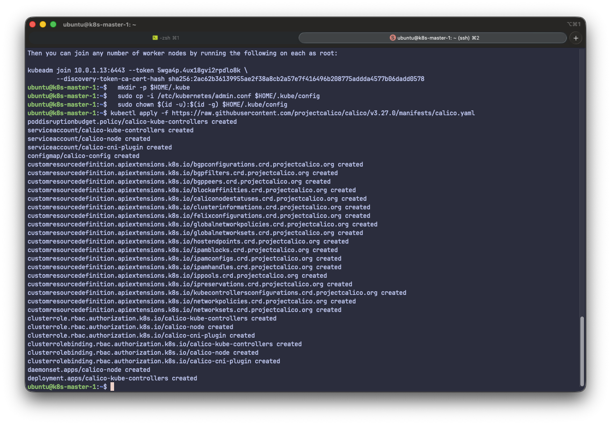
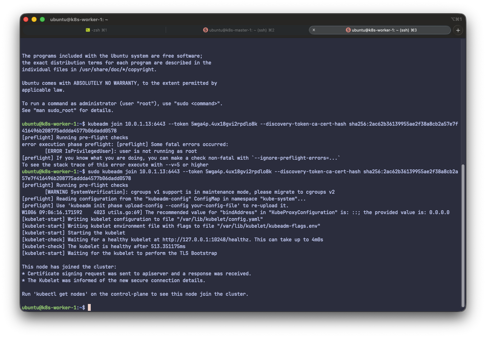
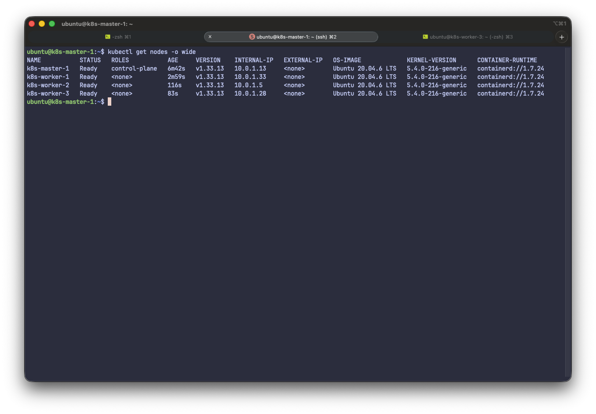

# Домашнее задание к занятию «Установка Kubernetes»

Создаем необходимые ВМ при помощи [Terraform](terraform)

Подключаемся по SSH к мастер-ноде. Проверяем про cloud-init завершен и инициализируем K8S кластер.

Подключаемся к первой воркер-ноде и подключаем ее к кластеру. Аналогичные действия производим на всех воркер-нодах.

Проверяем состояние K8S кластера

